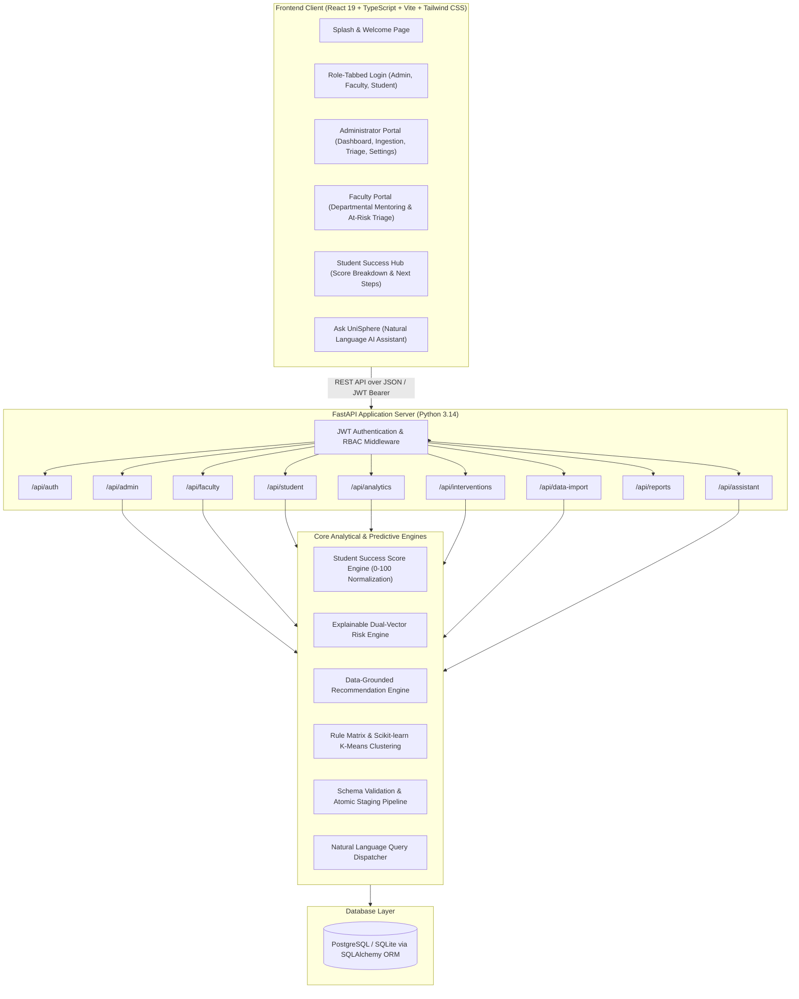
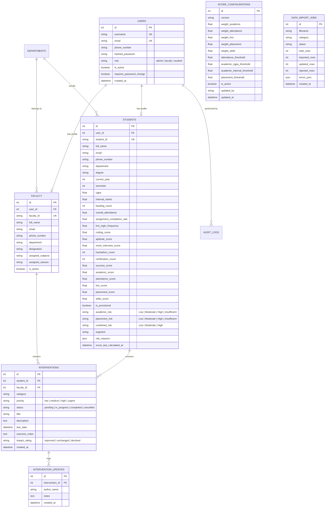
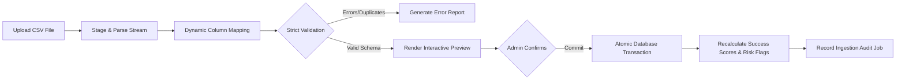

# UniSphere AI — System Architecture & Database Design

## 1. High-Level System Architecture

---

## 2. Database Entity-Relationship Diagram (ERD)

---

## 3. Data Integration & Staging Pipeline

